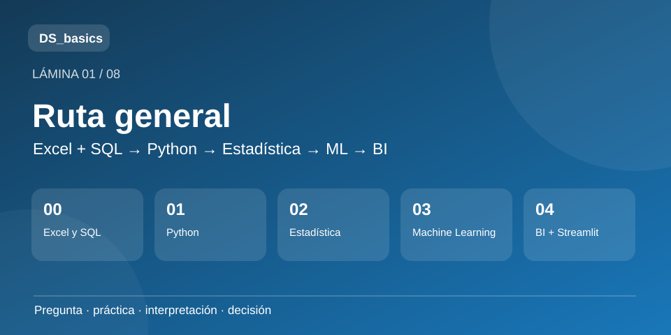
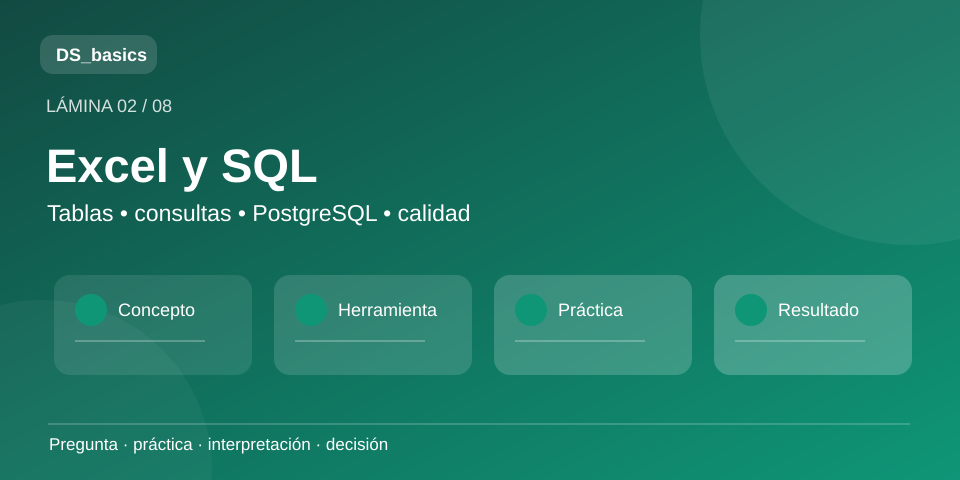
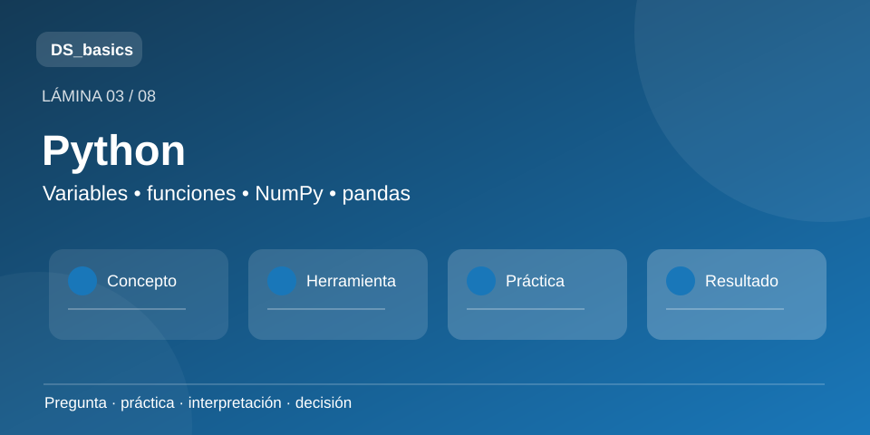
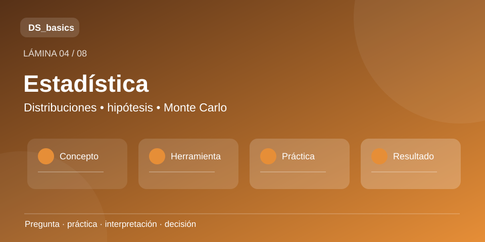
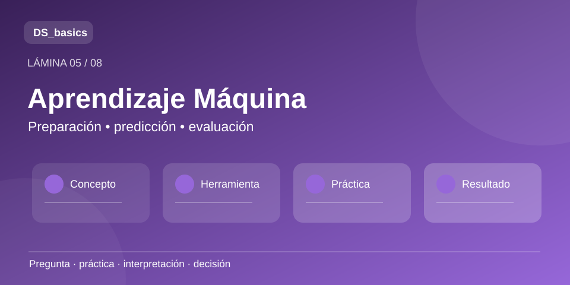
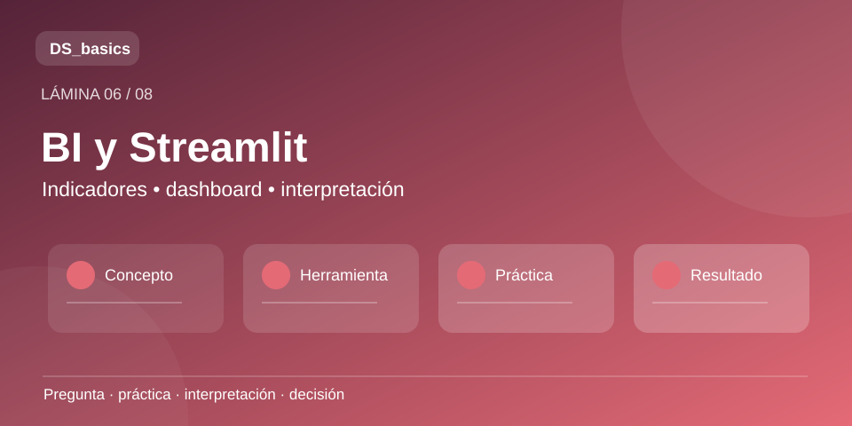
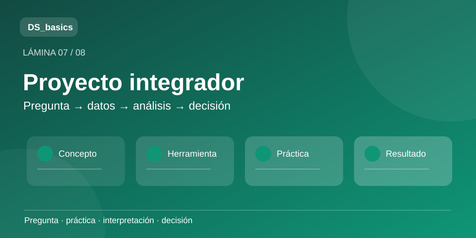
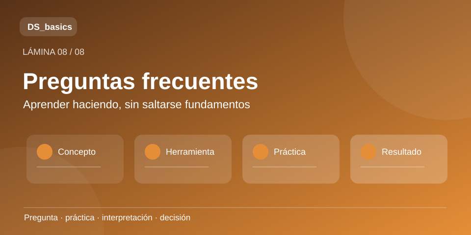

<div align="center">
  

  <h2>Fundamentals of Data Science</h2>
  <p><strong>Excel · SQL · Bases de datos · Python · Estadística · Machine Learning · Business Intelligence</strong></p>
  <p>Una colección de materiales para aprender haciendo: organizar y consultar datos, programar, analizar, construir modelos, visualizar resultados y conectarlos con problemas reales.</p>
  <p><strong>Ruta de aprendizaje:</strong> Excel y SQL → Python → Estadística → Machine Learning → BI y proyectos integradores</p>
</div>

---

## 🧭 ¿Qué encontrarás aquí?

El repositorio está organizado como una ruta progresiva. Cada módulo contiene notebooks y guías en Markdown que resumen qué se estudia, por qué importa y dónde puede aparecer en un problema real.

> Las guías acompañan a las notebooks; no las sustituyen. La idea es que puedas orientarte rápido y después experimentar directamente con el código.

| Módulo | Enfoque | Empieza aquí |
|---|---|---|
| 📚 00 · Excel y SQL | Hojas de cálculo, PostgreSQL, consultas y casos aplicados | [Ver módulo](./00%20Fundamentos%20de%20Datos%20-%20Excel%20y%20SQL/README.md) |
| 🐍 01 · Programación en Python | Desde cero hasta NumPy, Pandas y visualización con una ruta guiada de seis notebooks | [Ver módulo](./01%20Programación%20en%20Python/README.md) |
| 📊 02 · Análisis Estadístico de Datos | Estadística descriptiva, probabilidad, hipótesis, Monte Carlo y obtención de datos | [Ver módulo](./02%20Análisis%20Estadístico%20de%20Datos/README.md) |
| 🧠 03 · Aprendizaje Máquina | Del perceptrón a preparación de datos, regresión, clasificación y evaluación | [Ver módulo](./03%20Aprendizaje%20Máquina/README.md) |
| 📈 04 · BI y proyectos | Dashboards, Streamlit y ejercicios integradores | [Ver módulo](./04%20Business%20Intelligence%20y%20Proyectos/README.md) · [Demo](https://dsbasics-dbshzxqrgyz64tknfthamr.streamlit.app/) |

---


## 🗺️ Ruta visual · infografías

Ocho láminas que acompañan el material escrito: una explicación gráfica del recorrido, los cinco módulos, el proyecto integrador y las preguntas frecuentes. Las vistas de abajo son **resúmenes vectoriales para GitHub**; para ver y editar los diseños completos, abre [la presentación en Canva](https://www.canva.com/d/cGwC58JWPPaLXpQ).

| [](https://www.canva.com/d/cGwC58JWPPaLXpQ) | [](https://www.canva.com/d/cGwC58JWPPaLXpQ) |
| **01 · Ruta general** · [Roadmap](#-qué-encontrarás-aquí)  | **02 · Excel y SQL** · [Módulo 00](./00%20Fundamentos%20de%20Datos%20-%20Excel%20y%20SQL/README.md)  |

| [](https://www.canva.com/d/cGwC58JWPPaLXpQ) | [](https://www.canva.com/d/cGwC58JWPPaLXpQ) |
| **03 · Python** · [Módulo 01](./01%20Programación%20en%20Python/README.md)  | **04 · Estadística** · [Módulo 02](./02%20Análisis%20Estadístico%20de%20Datos/README.md)  |

| [](https://www.canva.com/d/cGwC58JWPPaLXpQ) | [](https://www.canva.com/d/cGwC58JWPPaLXpQ) |
| **05 · Aprendizaje Máquina** · [Módulo 03](./03%20Aprendizaje%20Máquina/README.md)  | **06 · BI y Streamlit** · [Módulo 04](./04%20Business%20Intelligence%20y%20Proyectos/README.md)  |

| [](https://www.canva.com/d/cGwC58JWPPaLXpQ) | [](https://www.canva.com/d/cGwC58JWPPaLXpQ) |
| **07 · Proyecto integrador** · [Proyecto](./04%20Business%20Intelligence%20y%20Proyectos/proyectos/caso_integrador.md)  | **08 · Preguntas frecuentes** · [Guía de uso](#-cómo-usar-este-material)  |

> La presentación Canva es editable; las ocho ilustraciones SVG son miniaturas estables y ligeras, compatibles con el README de GitHub.

---

## 🔁 Cómo usar este material

1. **Lee la guía** del subtema para obtener el mapa general.
2. **Abre la notebook** y ejecuta las celdas en orden.
3. **Modifica valores y ejemplos**; evita usar la notebook como una receta cerrada.
4. **Haz el mini reto** sugerido en el material.
5. Pregúntate: **¿qué decisión o problema real podría resolver con esto?**

```text
concepto → notebook → experimento → interpretación → aplicación
```

---

## 🧩 Filosofía del repositorio

El objetivo no es memorizar sintaxis ni acumular algoritmos. Es desarrollar una forma de trabajo:

- formular mejores preguntas;
- ordenar información;
- analizar con criterio;
- comunicar lo encontrado;
- construir soluciones reproducibles;
- reconocer las limitaciones de los datos y de los modelos.

Los ejemplos aplicados que aparecen en las guías son **conexiones pedagógicas**: sirven para imaginar usos posibles sin afirmar que cada caso esté implementado dentro de la notebook.

---

## 🚧 En evolución

El módulo de **Aprendizaje Máquina** está deliberadamente en construcción. La ruta ya reúne seis notebooks: perceptrón, redes neuronales, preparación de datos, regresión, clasificación y evaluación de modelos. Seguiremos ampliando los ejercicios con criterio y sin sacrificar claridad.

---

## 🛠️ Requisitos

Las notebooks utilizan Python 3 y librerías comunes del ecosistema científico. Puedes trabajar localmente con Jupyter o utilizar Google Colab cuando sea conveniente. No es necesario dominar todos los temas antes de comenzar: el repositorio también funciona como material de consulta y práctica.

---

<p align="center"><strong>Aprender datos es aprender a convertir preguntas en evidencia.</strong></p>
